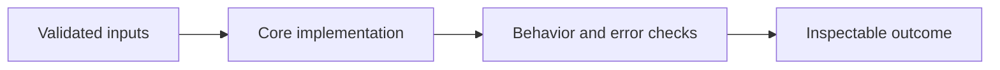

# Multimodal Moderation Decision Core

**Feras Elghandour** · Technical case study

Apply consistent moderation policy across text, image, audio, and video while keeping provider failures visible in aggregate metrics.

## Implementation

Typed assessments, score validation, configurable decision thresholds, fail-closed provider errors, and content-free moderation analytics.



## Evidence and results

The original application integrates four media modalities and moderation analytics. This release isolates a provider-neutral decision core and verifies threshold behavior, invalid assessments, provider failures, and aggregate accounting with synthetic cases. No new live-model accuracy figure is claimed.

This public edition contains a standalone refactor and focused tests. Saved experimental outcomes and the current component checks have separate scopes; the refactor has not been used to recertify the original benchmark.

## Run the checks

Python 3.11 or later.

```sh
python -m venv .venv
source .venv/bin/activate
python -m pip install -r requirements.txt
python smoke_test.py
```

See [DATA.md](DATA.md) for input contracts and [VALIDATION.md](VALIDATION.md) for the verification scope. The modules expose small APIs that can be integrated into a larger workflow.

## Practical relevance and limitations

A score threshold is a policy decision, not calibrated model quality. Provider callbacks still need modality-specific evaluation. Failing closed can overblock harmless content, and the analytics do not measure model fairness or production performance.

No client deployment, commercial outcome, or new live-provider performance is inferred from the component tests.
