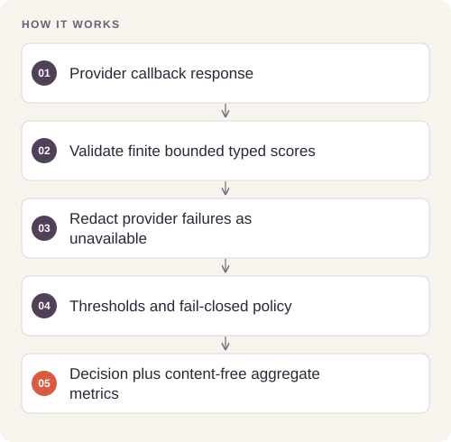

# Multimodal Moderation Decision Core

Apply consistent moderation policy across text, image, audio, and video while keeping provider failures visible in aggregate metrics.

## Implementation

Typed assessments, score validation, configurable decision thresholds, fail-closed provider errors, and content-free moderation analytics.




## Validate moderation-provider contracts

An empty successful provider assessment now becomes an unavailable assessment and follows the declared fail-closed policy. The malformed-response regression is included.

[Commands, artifacts and benchmark scope](BENCHMARKS.md) · [Versioned profiles](reproduction.json)


## Try a small example

A small offline fixture exercises the public implementation. It demonstrates the behavior shown below; it does not replace the historical dataset, benchmark or production validation.

After the local setup below, run from the repository root:

```sh
python examples/quickstart.py
```

The [example source](examples/quickstart.py), [captured output](examples/expected-output.txt) and [execution record](examples/environment.json) keep this demonstration inspectable. Floating-point values may vary with library versions.

Observed output from this run:

```text
{'total': 3, 'blocked': 2, 'blocked_fraction': 0.6666666666666666, 'errors': 1, 'modalities': {'text': 1, 'image': 1, 'video': 1}, 'categories': {'abuse': 1}}
```

## Evidence and results

The original application integrates four media modalities and moderation analytics. This release isolates a provider-neutral decision core and verifies threshold behavior, invalid assessments, provider failures, and aggregate accounting with synthetic cases. No new live-model accuracy figure is claimed.

This public edition contains a standalone refactor and focused tests. Saved experimental outcomes and the current component checks have separate scopes; the refactor has not been used to recertify the original benchmark.

## Run the checks

Python 3.11 or later.

```sh
python -m venv .venv
source .venv/bin/activate
python -m pip install -r requirements.txt
python smoke_test.py
```

See [DATA.md](DATA.md) for input contracts and [VALIDATION.md](VALIDATION.md) for the verification scope. 

## Practical relevance and limitations

A score threshold is a policy decision, not calibrated model quality. Provider callbacks still need modality-specific evaluation. Failing closed can overblock harmless content, and the analytics do not measure model fairness or production performance.

No client deployment, commercial outcome, or new live-provider performance is inferred from the component tests.

## Reuse

The original contributions listed in [LICENSING.md](LICENSING.md) are available under [MIT](LICENSE). This scoped grant preserves upstream notices and separate dataset, simulator, notebook and checkpoint terms.
